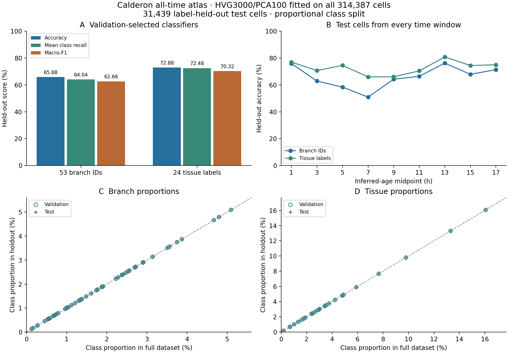

# Calderon classifiers across all timepoints

HVG selection and PCA were refitted on **all 314,387 lineage-assigned cells**. Every inferred-age window from 0–18 h contributes; no time window is reserved. The classifiers use the new **3,000 HVGs and PCA100** representation, with a shared branch-stratified 80/10/10 label split.

| Target | Selected predictor | Test cells | Accuracy | Mean per-class recall | Macro-F1 |
| --- | --- | ---: | ---: | ---: | ---: |
| Branch IDs (53) | residual_mixup_ema+wide+joint | 31,439 | **65.88%** | 64.04% | 62.66% |
| Broad tissues (24) | residual_mixup_ema+joint+wide | 31,439 | **72.88%** | 72.48% | 70.32% |



## Data and evaluation scope

The training, validation and test sets contain **251,509 / 31,439 / 31,439 cells**. All 53 branches, all 24 tissues and all nine time windows are present in every split. Branches map deterministically to tissues, so branch stratification also preserves tissue proportions.

| Label target | Largest validation deviation from full-dataset share | Largest test deviation |
| --- | ---: | ---: |
| Branches | 0.00187 percentage points | 0.00160 percentage points |
| Tissues | 0.00210 percentage points | 0.00250 percentage points |

The proportions follow the dataset's class frequencies. They are not uniform across classes. `split_proportions.csv` provides every class count/share and the time-window breakdown.

This is **transductive label-held-out accuracy**: validation/test labels are excluded from supervised training, while their expression profiles enter the requested all-cell HVG/PCA fit. The classifier's additional PC standardizer uses training cells only. Model/ensemble selection and temperature calibration use validation labels only, and choices are frozen before test scores are evaluated. These are random cell holdouts from the same atlas, measuring recovery of the released computational annotations.

Only cells with released lineage assignments are included. The 18–20 h cells lack those assignments. The classifiers receive PCA100 only; age, cluster and annotation metadata are not predictor inputs.

## Representation and training

Seurat v3 variance stabilization (LOESS span 0.3, genes detected in at least three cells) selects 3,000 HVGs from the original sparse integer counts. Each cell is normalized to 10,000 using its complete 23,932-feature library, then log1p transformed. Gene scaling and exact covariance PCA fit every labelled cell. PCA100 explains **10.98%** of scaled HVG variance. A 256-cell dense projection check had maximum absolute error **2.35e-05**.

Nine new neural networks cover five established recipes: wide, stronger class weighting, residual, residual with mixup/noise/label smoothing/EMA, and joint branch+tissue prediction with hierarchical consistency. Training uses AdamW, clipping at 5, five-epoch warmup and cosine decay, batch size 2,048, a 160-epoch limit and 30-epoch early-stopping patience. Each target selects its validation macro-F1 checkpoint. Calibrated ensembles contain at most three members and require a validation macro-F1 gain of 0.0005 per addition. This is one initialization/split seed.

| Target | Recipe | Validation macro-F1 | Test accuracy | Test macro-F1 | Selected |
| --- | --- | ---: | ---: | ---: | --- |
| branch_id | wide | 62.89% | 64.96% | 62.04% |  |
| branch_id | wide_balanced | 62.37% | 64.46% | 61.34% |  |
| branch_id | residual | 62.76% | 64.94% | 61.50% |  |
| branch_id | residual_mixup_ema | 63.20% | 65.39% | 61.80% |  |
| branch_id | joint | 62.81% | 65.08% | 61.88% |  |
| branch_id | ensemble | 63.80% | 65.88% | 62.66% | yes |
| broad_tissue | wide | 70.10% | 72.17% | 69.51% |  |
| broad_tissue | wide_balanced | 69.59% | 71.29% | 68.53% |  |
| broad_tissue | residual | 70.03% | 72.10% | 69.19% |  |
| broad_tissue | residual_mixup_ema | 70.40% | 72.06% | 69.51% |  |
| broad_tissue | joint | 70.30% | 72.19% | 69.44% |  |
| broad_tissue | ensemble | 71.19% | 72.88% | 70.32% | yes |

## Classifier confidence

| Target | Test coverage at probability ≥0.9 | Accuracy among those cells | Test ECE |
| --- | ---: | ---: | ---: |
| branch_id | 29.04% | 95.93% | 0.0184 |
| broad_tissue | 39.36% | 96.40% | 0.0177 |

## Artifacts and reproduction

Dataset: `/Users/harryamad/Desktop/drive/2026/flow-maps/datasets/calderon2022/all_times/lineage_assigned_hvg3000_pca100_all_times.h5ad`.

Classifier directory: `/Users/harryamad/Desktop/drive/2026/flow-maps/calderon-classifiers/all_times`. `models/` contains a selected manifest for each target and `search/` contains reloadable PyTorch checkpoints and validation curves. `reports/` contains all scores, per-class confusion/recall, per-window performance and selected test probabilities. The manifests require this new PCA space. Existing flow models were fitted in their earlier PCA spaces.

The audit recomputes both selected test metrics, checks the full-cell PCA fitting indices, verifies disjoint label splits, class proportions, validation-only selection, frozen checkpoint hashes and probability reloads. Original counts and both earlier latent datasets are unchanged. The three all-time data checks and five shared neural-network checks passed. `results_validation.json`, `evaluation_complete.json` and `implementation_hashes.json` record verification.

```sh
OPENBLAS_NUM_THREADS=4 OMP_NUM_THREADS=4 /opt/anaconda3/envs/maizels2023aa/bin/python \
  scripts/prepare_calderon_all_times_data.py

OPENBLAS_NUM_THREADS=4 OMP_NUM_THREADS=4 /usr/bin/caffeinate -i \
  /opt/anaconda3/envs/maizels2023aa/bin/python scripts/train_calderon_all_times_classifiers.py --device mps
```
