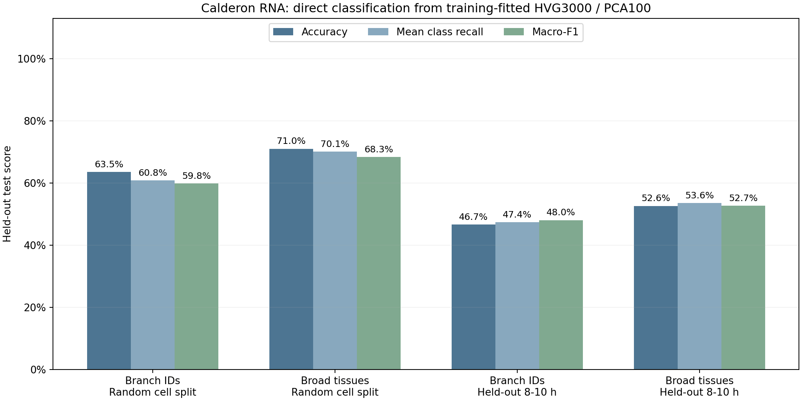

# Calderon RNA: PCA100 classifier feasibility

The downloaded RNA count matrix was pruned to **314,387 lineage-assigned cells**, 23,932 original features, **53 branch IDs** and **24 broad labels**. The retained matrix has 110,680,144 entries and 184,972,858 UMIs.

Both targets are trained directly using exactly the same cells, train/validation/test partitions and PCA100 features. Only PCA features enter the classifiers; inferred time, cluster IDs and annotations are not predictor inputs.

## Held-out results

| Target | Protocol | Model | Output / test-present classes | Test cells | Accuracy | Mean class recall | Macro-F1 |
| --- | --- | --- | ---: | ---: | ---: | ---: | ---: |
| Branch IDs | Entire 8-10 h bin | mlp | 53 / 27 | 58,004 | 46.68% | 47.38% | 48.04% |
| Branch IDs | Random cells | linear | 53 / 53 | 31,439 | 59.83% | 56.04% | 56.43% |
| Branch IDs | Random cells | mlp | 53 / 53 | 31,439 | 63.51% | 60.80% | 59.81% |
| Broad tissues | Entire 8-10 h bin | mlp | 24 / 20 | 58,004 | 52.62% | 53.59% | 52.72% |
| Broad tissues | Random cells | linear | 24 / 24 | 31,439 | 64.19% | 59.61% | 60.84% |
| Broad tissues | Random cells | mlp | 24 / 24 | 31,439 | 71.02% | 70.09% | 68.33% |



## Feasibility interpretation

Direct broad-tissue prediction gains **7.51 percentage points** of accuracy over branch-ID prediction on the random split and **5.94 points** on the held-out developmental window. The latter achieves 52.62% tissue accuracy versus 46.68% branch accuracy. At this baseline, the coarser labels are the more practical starting point for an additional flow experiment. The substantial errors, particularly across developmental windows, argue for reporting classifier uncertainty and using soft label probabilities. An experiment that treats every predicted branch as a correct hard label is not supported by these results.

These are single-seed baseline results with the repo's existing MLP architecture, not an exhaustive search for the best possible classifier. Each MLP is allowed up to 100 epochs with early stopping; the best validation-loss checkpoint is selected. The random split shares atlas collection groups across training and testing, and the temporal split holds out an expression-inferred age window. Neither is an independent-embryo validation.

## Confidence and coverage

The following subsets keep test cells whose predicted probability is at least 0.9. They are descriptive subsets of the same fitted models; the full-population results above remain the primary comparison.

| Target | Protocol | Coverage | Accuracy within subset | Cells |
| --- | --- | ---: | ---: | ---: |
| Branch IDs | Random cells | 17.03% | 98.21% | 5,355 |
| Broad tissues | Random cells | 23.04% | 98.62% | 7,244 |
| Branch IDs | Entire 8-10 h bin | 12.83% | 97.03% | 7,440 |
| Broad tissues | Entire 8-10 h bin | 17.57% | 98.01% | 10,190 |

High confidence improves reliability but leaves most cells outside the retained subset. Its coverage must be reported if it is used in a downstream experiment.

## Weakest classes

The five lowest-recall classes present in each MLP test split are shown below. The complete CSV files also contain precision, F1 and training/validation support.

| Target | Protocol | Assigned label | Test cells | Recall |
| --- | --- | --- | ---: | ---: |
| Branch IDs | Random cells | `Ubi_CDB` | 86 | 5.81% |
| Branch IDs | Random cells | `Ubi_CD` | 174 | 25.29% |
| Branch IDs | Random cells | `Ubi_AA` | 795 | 27.04% |
| Branch IDs | Random cells | `Ubi_BDAB` | 424 | 33.25% |
| Branch IDs | Random cells | `Ubi_BCA` | 1,216 | 35.36% |
| Broad tissues | Random cells | `Mesoderm` | 320 | 41.88% |
| Broad tissues | Random cells | `Visceral muscle` | 420 | 43.81% |
| Broad tissues | Random cells | `Neural` | 1,538 | 51.50% |
| Broad tissues | Random cells | `Brain` | 2,409 | 56.54% |
| Broad tissues | Random cells | `Tracheal sys.` | 1,332 | 57.28% |
| Branch IDs | Entire 8-10 h bin | `Ubi_CDBA` | 1,458 | 0.89% |
| Branch IDs | Entire 8-10 h bin | `Ubi_BA` | 1,678 | 3.10% |
| Branch IDs | Entire 8-10 h bin | `Ubi_AA` | 2,470 | 3.16% |
| Branch IDs | Entire 8-10 h bin | `Ubi_CDBB` | 1,909 | 12.31% |
| Branch IDs | Entire 8-10 h bin | `Ubi_BCAA` | 3,483 | 12.75% |
| Broad tissues | Entire 8-10 h bin | `Muscle/Ubi` | 1,458 | 3.57% |
| Broad tissues | Entire 8-10 h bin | `Tracheal sys.` | 1,678 | 10.85% |
| Broad tissues | Entire 8-10 h bin | `Crystal cells` | 1,909 | 12.73% |
| Broad tissues | Entire 8-10 h bin | `Somatic muscle` | 3,108 | 22.23% |
| Broad tissues | Entire 8-10 h bin | `Neural` | 5,885 | 28.90% |

## Coarsening the branch classifier's probabilities

As a separate diagnostic, sum each branch classifier's probabilities over branches mapped to the same broad tissue. This uses the already trained branch model; it is distinct from the directly trained broad-tissue classifiers above.

| Protocol | Aggregated branch accuracy | Aggregated branch macro-F1 | Direct tissue accuracy | Direct tissue macro-F1 |
| --- | ---: | ---: | ---: | ---: |
| Random cells | 71.34% | 68.08% | 71.02% | 68.33% |
| Entire 8-10 h bin | 52.53% | 52.28% | 52.62% | 52.72% |

## Evaluation and preprocessing

The random-cell protocol uses a branch-stratified 80/10/10 split. The temporal protocol places every assigned 8-10 h cell in the test set, then splits the other cells 90/10 into training/validation. Every branch and broad tissue remains represented in training. Macro-F1 and mean recall average only classes present in the evaluated split; absent classes are retained in the model head and per-class CSV reports.

HVG selection uses Seurat v3's raw-count variance-stabilisation formula (LOESS span 0.3), restricted to genes detected in at least three training cells. The 3,000 highest-scoring features are normalised using each cell's complete original library size (target 10,000), then log1p transformed. Gene means, unit-variance scaling and exact covariance PCA100 are fitted on training cells only. The PC scaler is also fitted only on training cells. Different evaluation protocols have different training-fitted PCA spaces; checkpoints must be paired with their corresponding representation.

The MLP matches the repo's existing 100 -> 128 -> 64 -> output architecture, with BatchNorm, ReLU and dropout 0.2. AdamW uses learning rate 0.001, weight decay 0.0001, inverse-frequency class-weight power 0.25 and label smoothing 0.05. A validation-loss scheduler and early stopping select the checkpoint without inspecting test performance. A linear-softmax baseline is fitted for the random-cell protocol.

## Data, checkpoints and detailed reports

- Raw pruned counts: `datasets/calderon2022/lineage_assigned_counts.h5ad` (integer cell-by-feature counts).
- Fitted representations: `datasets/calderon2022/lineage_assigned_hvg3000_pca100_{random,heldout_8_10}.h5ad`; `X` contains log-normalised HVGs, `obsm['X_pca']` contains PCA100, and `obs` retains branch, broad tissue, manual annotation and both clocks.
- Both `.pt` and `.npz` checkpoints are in `calderon-classifiers/`; MLP exports use the existing repo schema.
- Metrics, per-class precision/recall/F1, per-window performance, training curves, row-normalised confusion matrices and recall plots are in `calderon-classifiers/reports/`.
- Per-cell test predictions are in the ignored `datasets/calderon2022/predictions/` directory.

The broad labels are the authors' **branch-level tissue decoder**, including `Unknown`; they are not independently measured per-cell tissue identities. `Unknown` accounts for 50,501 retained cells (16.06%). The branch labels and inferred time coordinate come from the atlas's computational reconstruction. This experiment measures recovery of those assigned labels on held-out expression profiles, not lineage-tracing accuracy.

## Reproduce

```sh
python scripts/prepare_calderon_lineage_data.py --stage prune
python scripts/train_calderon_lineage_classifiers.py
# Regenerate the report from completed results:
python scripts/train_calderon_lineage_classifiers.py --report-only
```

Dependencies are NumPy, SciPy, pandas, AnnData, openpyxl, scikit-misc, scikit-learn, PyTorch and matplotlib; `rdata` is needed to parse the downloaded annotation RDS when a previously parsed cache is unavailable. The download/pruning script verifies source hashes, all retained per-cell detected-feature/UMI totals, the full source entry/UMI totals and gzip CRC. Numerical tests compare the bounded-memory VST calculation with Scanpy and implicit PCA with dense scikit-learn PCA.

The complete download hashes are recorded in [download_manifest.json](download_manifest.json). The [saved-model validation audit](classifier_validation.json) verifies raw-to-PCA projection on 256 sampled cells, training-index/feature alignment, identical branch/tissue splits, and reproduction of all six test metrics from reloaded PyTorch checkpoints. It also verifies the MLP exports through the repository's existing NumPy classifier loader.
