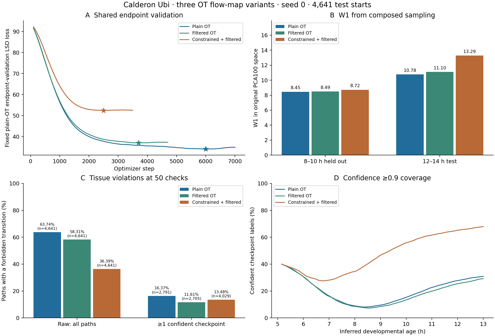

# Calderon constrained OT flow-map results

Relative to filtering alone, adding the native Maizels lineage penalty changes raw path violations **58.31% → 36.39%**. Confidence-filtered violations change **11.61% → 13.48%**, with assessed-path coverage **58.28% → 86.81%**.

Middle W1 changes **8.4856 → 8.7176**, and endpoint W1 changes **11.1041 → 13.2912**. Higher W1 is worse. At this weight-1000 setting, the reduction in raw violations comes with worse agreement with both observed marginals.

The seed-0 run completed **3,500 updates** in **75.39 minutes**. The shared plain-OT endpoint-validation objective selected **step 2,500** with loss **52.4641**. All variants evaluate the same 4,641 test starting cells, 50 checking points and 100-step composed sampling.



| Metric | Plain OT | Filtered OT | Constrained + filtered OT |
| --- | ---: | ---: | ---: |
| 8–10 h held-out W1 | 8.4545 | 8.4856 | 8.7176 |
| 12–14 h test W1 | 10.7758 | 11.1041 | 13.2912 |
| Raw path violations | 63.74% | 58.31% | 36.39% |
| Confidence-filtered violations among assessed paths | 16.37% | 11.61% | 13.48% |
| At least one confident checkpoint: coverage | 60.14% | 58.28% | 86.81% |
| All 50 checkpoints confident: coverage | 1.85% | 2.13% | 3.75% |
| Raw endpoint-only violations | 27.49% | 23.06% | 16.22% |

Constrained raw violations: **1,689/4,641 paths**. Confidence-filtered violations: **543/4,029 assessed paths**, with **612 unassessed**. Only **174 paths** have confident labels at every checking point. Skipped checkpoints are not demonstrated valid states.

W1 uses Euclidean PCA100 ground cost and the same 2,048 generated/reference samples. The middle state is obtained after 50 composed steps and the endpoint after 100. Neither reported W1 score selects a checkpoint.

For context, unchanged starting cells have middle/end W1 **8.2913 / 14.7481**. Disjoint real-versus-real samples give **6.1406 / 10.2368**. These are descriptive controls, not formal lower bounds or subtractive corrections. [The baseline report](ot_flow_map_results.md) documents their construction.

## Active training constraint

This is Maizels ID 6 with the same filtered OT pairs as ID 5. On the 32 off-diagonal loss samples per batch, the frozen classifier predicts probabilities at the observed interpolant I_s and the learned flow-map output X_{s,t}(I_s). The added loss is **1000 × mean[-log(clip(p_sᵀ R p_t, 10⁻⁶, 1))]**, where R is the existing projected allowed-tissue relation. The native off-diagonal normalization preserves this weight despite the 75% diagonal fraction. Start, final-label and entropy penalties are zero, matching the repository defaults. The classifier remains frozen, and the network remains unconditional.

The constraint uses the supplied relation directly, with no new transitive closure after tissue merging. It penalizes sampled flow-map transitions; it does not enforce a hard constraint on every point of the final composed paths.

## Filter, mass and uncertainty

The original full 50-point interpolant check remains active. Across **3,500 batches**, **12,584,718 candidate interpolants** were checked and **11,373,376 rejected** (90.37%). Mean retained valid mass was **82.55%**. Partial assignments are renormalized, so effective training tissue fractions differ from the endpoint snapshots. These statistics include all completed updates, including those after the selected checkpoint.

| Model | Starting-label group | Test starts | Raw violations | Filtered violations | Assessed-path coverage |
| --- | --- | ---: | ---: | ---: | ---: |
| Plain | Named tissue | 2,211 | 73.68% | 50.17% (455/907) | 41.02% |
| Plain | Unknown | 2,430 | 54.69% | 0.11% (2/1,884) | 77.53% |
| Filtered | Named tissue | 2,211 | 67.30% | 36.97% (312/844) | 38.17% |
| Filtered | Unknown | 2,430 | 50.12% | 0.11% (2/1,861) | 76.58% |
| Constrained | Named tissue | 2,211 | 49.34% | 29.92% (537/1,795) | 81.18% |
| Constrained | Unknown | 2,430 | 24.61% | 0.27% (6/2,234) | 91.93% |

For named-tissue starts, confidence-filtered violations fall **36.97% → 29.92%**, while coverage rises **38.17% → 81.18%**. Named-tissue starts increase from **31.20% to 44.55%** of the aggregate assessed denominator. The aggregate filtered rate therefore needs the label-group breakdown: the groups have very different violation rates, and the set of assessed paths and checkpoints changes between models.

The same frozen classifier builds the training filter, supplies constraint gradients and scores generated paths. Its real 8–10 h Ubi accuracy is 48.24%. The unchanged-expression control already gives 15.49% raw violations. These results measure agreement with the reconstructed prior and classifier, rather than independent clone-fate accuracy. The existing reference-atlas PCA/classifier can have seen endpoint flow-test cells. This is one training seed.

## Verification and artifacts

The audit confirms identical network/optimizer settings, cell splits, source/reference samples, classifier and graph hashes; the checkpoint is the minimum shared validation loss and excludes the lineage penalty. Both reference runs are unchanged. Filter statistics match filtering alone at every logged common optimizer step. The differentiable decoder reproduced all decisions and ≥0.9 confidence masks on 6,912 training-cell/interpolant points with maximum probability error below 6×10⁻⁷. Its native loss gradient matched directional finite differences. All 23 Calderon checks, 10 shared OT/lineage checks and a genuine constrained training/evaluation smoke run passed.

Run directory: `/Users/harryamad/Desktop/drive/2026/flow-maps/outputs/calderon_ubi_constrained_filtered_ot_flow_map_seed0`. Inspect `metrics.json`, `training_summary.json`, `pair_filtering_summary.json`, `comparison_protocol.json`, `classifier_gradient_verification.json`, `implementation_hashes.json`, `reference_artifact_hashes.json`, `best.msgpack` and the per-cell evaluation artifacts. [Method and reproduction commands](constrained_flow_map.md) describe the implementation.

```sh
/opt/anaconda3/envs/flowmaps/bin/python scripts/report_calderon_constrained_flow_map.py
```
