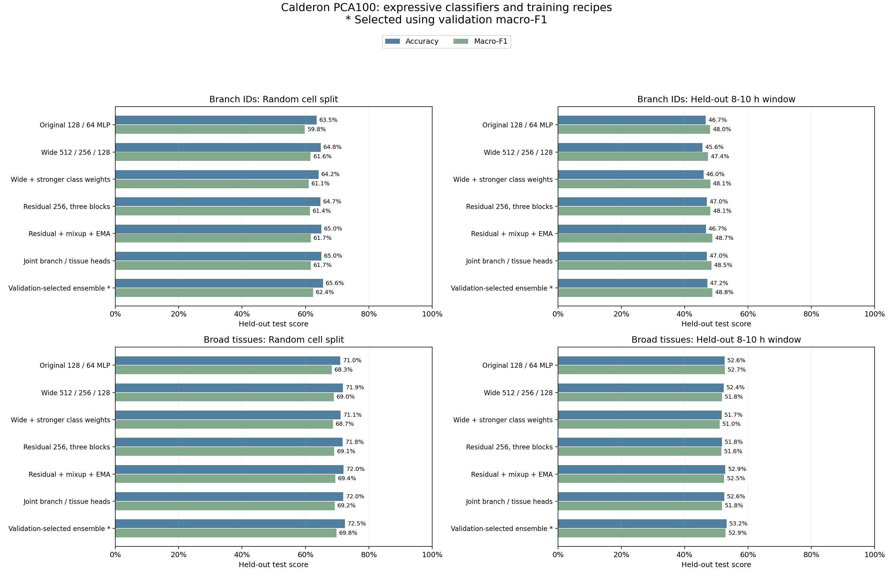
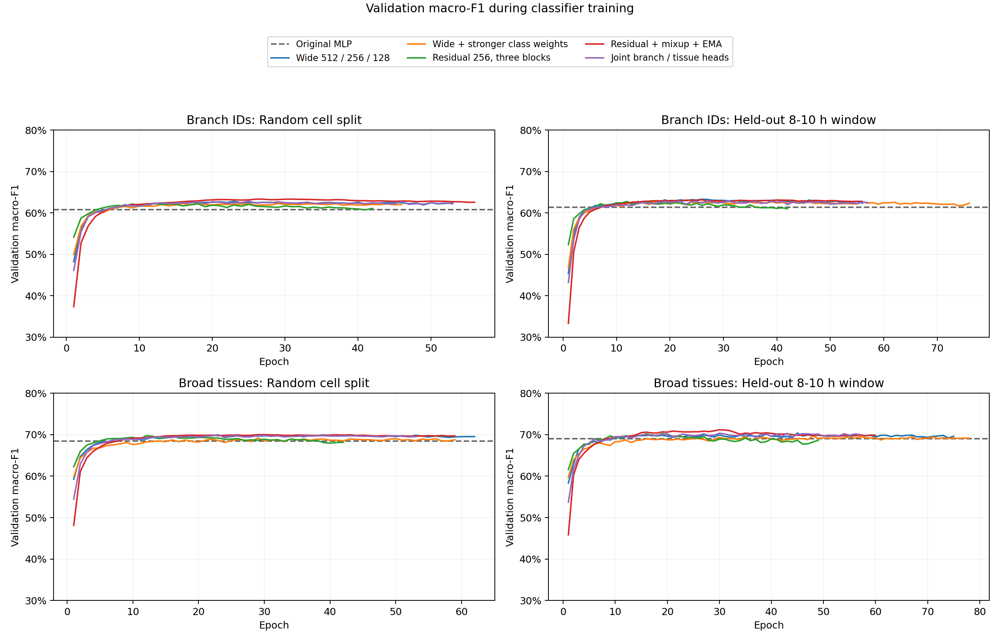

# Calderon PCA100: expressive classifiers and training recipes

This follow-up trained **18 new networks** on the same 314,387 assigned RNA profiles, the same training-fitted HVG3000/PCA100 spaces and the same random-cell and held-out 8-10 h splits as the [original classifier pilot](classification.md). Joint models provide separately evaluated branch and tissue heads.

Network checkpoints and recipes were selected using validation macro-F1. Probability temperatures and ensembles were fitted/selected on validation cells only; [selection.json](../../calderon-classifiers/expressive/selection.json) was written before any new test evaluation. The test cells are the same ones used in the previous pilot.

## Original versus validation-selected results

| Protocol | Target | Selected method | Original accuracy | New accuracy | Original macro-F1 | New macro-F1 |
| --- | --- | --- | ---: | ---: | ---: | ---: |
| Random cells | Branch IDs | Validation-selected ensemble | 63.51% | 65.56% | 59.81% | 62.43% |
| Random cells | Broad tissues | Validation-selected ensemble | 71.02% | 72.45% | 68.33% | 69.82% |
| Entire 8-10 h window | Branch IDs | Validation-selected ensemble | 46.68% | 47.17% | 48.04% | 48.76% |
| Entire 8-10 h window | Broad tissues | Validation-selected ensemble | 52.62% | 53.25% | 52.72% | 52.94% |

The selected method is the validation winner, not the largest score observed on the test set. Accuracy and macro-F1 gains in percentage points are:

- Branch IDs, random cells: accuracy +2.05 points; macro-F1 +2.63 points.
- Broad tissues, random cells: accuracy +1.43 points; macro-F1 +1.49 points.
- Branch IDs, entire 8-10 h window: accuracy +0.49 points; macro-F1 +0.71 points.
- Broad tissues, entire 8-10 h window: accuracy +0.62 points; macro-F1 +0.22 points.

The selected predictors gain 1.43–2.05 accuracy points on random held-out cells, and 0.49–0.62 points on the held-out developmental window. The detailed recipe table shows that extra capacity alone can reduce performance on the held-out window. Within this search, regularisation and probability averaging provide modest improvements but leave the cross-stage classification problem unresolved. Coarser labels remain easier to recover; the remaining errors still require classifier uncertainty to be included in a downstream flow experiment.



## Recipes and training

| Recipe | Network | Changes from the original training |
| --- | --- | --- |
| Wide | 100 -> 512 -> 256 -> 128 -> output, BatchNorm and GELU | Dropout 0.1; no label smoothing; class-weight power 0.25 |
| Wide balanced | Same wide network | Increase class-weight power to 0.5 |
| Residual | Width 256; three pre-LayerNorm residual blocks, 128-unit bottlenecks; GELU | Dropout 0.1; no label smoothing; class-weight power 0.25 |
| Residual + mixup + EMA | Same residual network | Mixup alpha 0.2; Gaussian PC noise SD 0.03; label smoothing 0.02; EMA decay 0.995 |
| Joint | Wide shared trunk, separate 53-branch and 24-tissue heads | Branch CE + 0.5 tissue CE + 0.1 Jensen-Shannon consistency between tissue probabilities and aggregated branch probabilities |

The new single-head networks have about 221k–239k parameters, compared with about 23k–25k in the original MLP. All new recipes use AdamW, initial learning rate 0.001, weight decay 0.0001, gradient clipping at 5, a five-epoch warmup and cosine decay to 2% of the initial rate. They are allowed up to 160 epochs, with early stopping after 30 epochs without a validation macro-F1 gain of at least 0.0005. Each joint head keeps its own best validation checkpoint; the two checkpoints can come from different epochs.

The PCA representation and PC scaler are unchanged and fitted on training cells only. Neither inferred time nor annotation metadata enters the network inputs. Joint training uses both available training labels, whose branch-to-tissue relationship is deterministic in the authors' decoder.



## All individual recipes and ensembles

| Protocol | Target | Method | Validation macro-F1 | Test accuracy | Test mean recall | Test macro-F1 | Selected |
| --- | --- | --- | ---: | ---: | ---: | ---: | --- |
| Random | Branch | Original 128 / 64 MLP | 60.79% | 63.51% | 60.80% | 59.81% |  |
| Random | Branch | Wide 512 / 256 / 128 | 62.81% | 64.82% | 62.99% | 61.65% |  |
| Random | Branch | Wide + stronger class weights | 62.28% | 64.18% | 63.84% | 61.06% |  |
| Random | Branch | Residual 256, three blocks | 62.32% | 64.73% | 62.80% | 61.43% |  |
| Random | Branch | Residual + mixup + EMA | 63.32% | 65.00% | 63.20% | 61.69% |  |
| Random | Branch | Joint branch / tissue heads | 62.85% | 64.98% | 62.94% | 61.69% |  |
| Random | Branch | Validation-selected ensemble | 63.66% | 65.56% | 64.37% | 62.43% | Yes |
| Random | Tissue | Original 128 / 64 MLP | 68.47% | 71.02% | 70.09% | 68.33% |  |
| Random | Tissue | Wide 512 / 256 / 128 | 70.00% | 71.87% | 70.83% | 69.01% |  |
| Random | Tissue | Wide + stronger class weights | 69.19% | 71.13% | 72.98% | 68.69% |  |
| Random | Tissue | Residual 256, three blocks | 69.77% | 71.77% | 70.98% | 69.11% |  |
| Random | Tissue | Residual + mixup + EMA | 70.03% | 72.04% | 71.92% | 69.40% |  |
| Random | Tissue | Joint branch / tissue heads | 70.00% | 71.96% | 71.43% | 69.25% |  |
| Random | Tissue | Validation-selected ensemble | 70.72% | 72.45% | 72.14% | 69.82% | Yes |
| 8-10 h held out | Branch | Original 128 / 64 MLP | 61.32% | 46.68% | 47.38% | 48.04% |  |
| 8-10 h held out | Branch | Wide 512 / 256 / 128 | 63.31% | 45.65% | 46.59% | 47.38% |  |
| 8-10 h held out | Branch | Wide + stronger class weights | 62.75% | 45.96% | 47.51% | 48.07% |  |
| 8-10 h held out | Branch | Residual 256, three blocks | 62.78% | 47.00% | 48.02% | 48.14% |  |
| 8-10 h held out | Branch | Residual + mixup + EMA | 63.17% | 46.71% | 48.13% | 48.75% |  |
| 8-10 h held out | Branch | Joint branch / tissue heads | 62.93% | 47.01% | 48.19% | 48.47% |  |
| 8-10 h held out | Branch | Validation-selected ensemble | 64.10% | 47.17% | 48.35% | 48.76% | Yes |
| 8-10 h held out | Tissue | Original 128 / 64 MLP | 69.08% | 52.62% | 53.59% | 52.72% |  |
| 8-10 h held out | Tissue | Wide 512 / 256 / 128 | 70.41% | 52.37% | 53.22% | 51.79% |  |
| 8-10 h held out | Tissue | Wide + stronger class weights | 69.71% | 51.72% | 54.20% | 51.05% |  |
| 8-10 h held out | Tissue | Residual 256, three blocks | 70.27% | 51.75% | 52.27% | 51.63% |  |
| 8-10 h held out | Tissue | Residual + mixup + EMA | 71.18% | 52.85% | 54.14% | 52.48% |  |
| 8-10 h held out | Tissue | Joint branch / tissue heads | 70.35% | 52.56% | 53.60% | 51.83% |  |
| 8-10 h held out | Tissue | Validation-selected ensemble | 71.93% | 53.25% | 54.38% | 52.94% | Yes |

## Ensembles and probability calibration

Each model receives a scalar temperature fitted to validation negative log likelihood over the range 0.35–3.0. This changes confidence but preserves an individual model's predicted class. Greedy probability averaging starts with the highest validation macro-F1 model and adds at most two other members; an addition requires a validation macro-F1 gain of at least 0.0005. A final temperature is fitted to the averaged validation probabilities. These choices are frozen before test evaluation.

| Protocol | Target | Ensemble members | Final temperature |
| --- | --- | --- | ---: |
| random | branch_id | residual_mixup_ema, wide_balanced, joint | 0.941 |
| random | broad_tissue | residual_mixup_ema, joint | 0.949 |
| heldout_8_10 | branch_id | wide, residual, joint | 0.937 |
| heldout_8_10 | broad_tissue | residual_mixup_ema, joint, residual | 0.928 |

The following confidence statistics are for the validation-selected predictors, after calibration. Calibration is fitted on the other atlas bins in the temporal protocol and can still be inaccurate on the held-out bin.

| Protocol | Target | Coverage at probability >= 0.9 | Accuracy within subset | Test log loss | Test ECE |
| --- | --- | ---: | ---: | ---: | ---: |
| random | branch_id | 28.62% | 96.03% | 1.042 | 0.019 |
| random | broad_tissue | 39.18% | 96.33% | 0.802 | 0.022 |
| heldout_8_10 | branch_id | 21.48% | 87.75% | 2.175 | 0.131 |
| heldout_8_10 | broad_tissue | 27.71% | 90.38% | 1.784 | 0.140 |

The ensembles remain overconfident on the held-out window: a 0.9 probability cutoff gives only 87.75% branch accuracy and 90.38% tissue accuracy within the retained subsets. The corresponding ECE values are 0.131 and 0.140. Higher random-cell accuracy does not establish reliable probabilities for other developmental stages.

## Remaining weak classes

The five lowest-recall classes present in each selected predictor's test split are listed below; complete per-class CSV files and selected-model confusion/recall plots are in the report directory.

| Protocol | Target | Assigned label | Test cells | Recall |
| --- | --- | --- | ---: | ---: |
| random | branch_id | `Ubi_CDB` | 86 | 16.28% |
| random | branch_id | `Ubi_AA` | 795 | 32.96% |
| random | branch_id | `Ubi_BCA` | 1,216 | 35.28% |
| random | branch_id | `Ubi_AC` | 987 | 38.80% |
| random | branch_id | `Ubi_BDB` | 590 | 38.81% |
| random | broad_tissue | `Mesoderm` | 320 | 48.75% |
| random | broad_tissue | `Visceral muscle` | 420 | 52.14% |
| random | broad_tissue | `Brain` | 2,409 | 56.95% |
| random | broad_tissue | `Neural` | 1,538 | 57.80% |
| random | broad_tissue | `Epidermis` | 4,181 | 61.83% |
| heldout_8_10 | branch_id | `Ubi_CDBA` | 1,458 | 0.89% |
| heldout_8_10 | branch_id | `Ubi_BA` | 1,678 | 3.16% |
| heldout_8_10 | branch_id | `Ubi_AA` | 2,470 | 4.33% |
| heldout_8_10 | branch_id | `Ubi_CDBD` | 2,841 | 8.34% |
| heldout_8_10 | branch_id | `Ubi_BCAA` | 3,483 | 10.88% |
| heldout_8_10 | broad_tissue | `Muscle/Ubi` | 1,458 | 1.99% |
| heldout_8_10 | broad_tissue | `Tracheal sys.` | 1,678 | 9.89% |
| heldout_8_10 | broad_tissue | `Crystal cells` | 1,909 | 17.08% |
| heldout_8_10 | broad_tissue | `Somatic muscle` | 3,108 | 26.80% |
| heldout_8_10 | broad_tissue | `Neural` | 5,885 | 29.53% |

## Data and evaluation scope

The random protocol has 251,509 training, 31,439 validation and 31,439 test cells. The temporal protocol has 230,744 training and 25,639 validation cells outside 8-10 h, and 58,004 test cells in 8-10 h. The latter test set contains 27 of the 53 branch IDs and 20 of the 24 broad labels; macro-F1 and mean recall average classes present in each evaluated split. Every class remains represented in training.

This is a single-seed search over five declared recipes in PCA100. The labels and time coordinate are the authors' atlas-derived annotations; broad labels are the branch decoder, including `Unknown`. The random protocol shares collection groups across splits. These results measure recovery of assigned labels, and the temporal test measures transfer to an expression-inferred age window, rather than independent-embryo or lineage-tracing accuracy.

## Reproduce and use the selected classifiers

```sh
python scripts/train_calderon_expressive_classifiers.py --stage search --device mps
python scripts/train_calderon_expressive_classifiers.py --stage freeze
python scripts/train_calderon_expressive_classifiers.py --stage evaluate
python scripts/train_calderon_expressive_classifiers.py --stage report
```

Use `--device cpu` for search when MPS is unavailable. Test inference and exported-model verification use CPU. The original HVG/PCA preparation does not need to be rerun.

Checkpoints and validation histories are under `calderon-classifiers/expressive/search/`. The four selected predictor manifests are under `calderon-classifiers/expressive/models/`, with relative checkpoint paths, scalers, label vocabularies and fitted temperatures. These larger architectures require the accompanying loader rather than the original fixed-width MLP loader:

```python
from scripts.train_calderon_expressive_classifiers import predict_selected
probabilities = predict_selected(
    'calderon-classifiers/expressive/models/heldout_8_10_broad_tissue_selected.json',
    pca100_cells,
)
```

Pass cells projected into the corresponding stored PCA100 space. `reports/results.csv` contains all scores; each method has per-class, per-window and confusion CSV files. Per-cell predictions are in the ignored `datasets/calderon2022/predictions/expressive/` directory. Selected predictor manifests are checked by reloading and reproducing 256 test-cell probability vectors.

