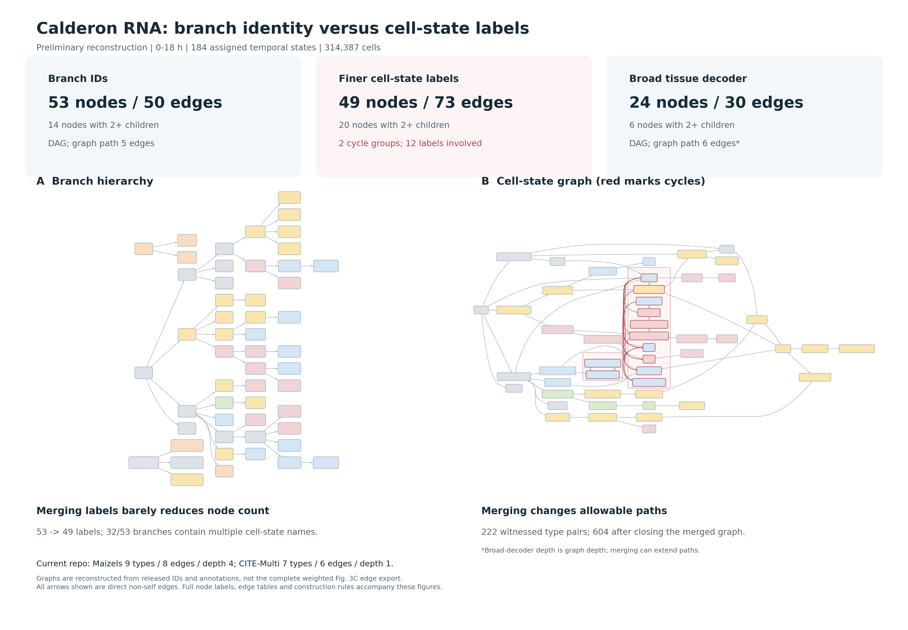

# Branch and cell-type graph comparison

These figures compare three representations of the Calderon RNA developmental data. **They are preliminary reconstructions from the released lineage IDs and annotations, not a verified reproduction of the complete weighted RNA graph in Figure 3C.** The exact RNA state-edge export has not been located in the public files inspected so far.

The comparison covers the **184 states and 314,387 cells with explicit lineage assignments at inferred ages 0-18 h**. It excludes the 84 unassigned states and the 18-20 h window. Every assigned branch is retained. Mixed, unknown and ubiquitous annotations are retained so their effect on the graph remains visible.



## Figures and exports

- **Branch-ID hierarchy:** [PNG](figures/branch_id_graph.png), [editable SVG](figures/branch_id_graph.svg).
- **Coarse graph over finer cell-state labels:** [PNG](figures/cell_state_graph.png), [editable SVG](figures/cell_state_graph.svg). Red edges and boxes mark groups of labels participating in directed cycles.
- **Further coarsening using the authors' broad tissue decoder:** [PNG](figures/broad_tissue_graph.png), [editable SVG](figures/broad_tissue_graph.svg).
- **Allowable-pair comparison:** [PNG](figures/allowable_pair_comparison.png), [editable SVG](figures/allowable_pair_comparison.svg).
- **All five figure pages:** [vector PDF](../../output/pdf/calderon2022_lineage_graphs.pdf).

## Complexity

Edges in the following table are **direct, non-self edges**, not the number of allowable ancestor-descendant pairs. A node with two or more outgoing edges is a graph fork; after merging cell types, it need not represent a distinct biological differentiation decision.

| Representation | Nodes | Direct edges | Nodes with 2+ children | Nodes with 2+ parents | Acyclic? | Longest directed graph path |
| --- | ---: | ---: | ---: | ---: | --- | --- |
| Branch IDs | 53 | 50 | 14 | 0 | Yes | 5 edges |
| Finer manual cell-state labels | 49 | 73 | 20 | 14 | No | Cyclic; no finite maximum walk length |
| Broad tissue decoder | 24 | 30 | 6 | 6 | Yes | 6 edges; may splice different branches |
| Current Maizels prior | 9 | 8 | 3 | 0 | Yes | 4 edges |
| Current CITE/Multi prior | 7 | 6 | 1 | 0 | Yes | 1 edge |

The branch graph has three roots, 31 leaves and a maximum of six children per node. The finer cell-state graph has one connected component and **12 labels in two strongly connected groups**: these are groups within which every label can reach every other label in the merged direct-edge graph. This is more than merely two individual cycles.

The broader graph's apparent six-edge depth is **not evidence of a deeper biological lineage than the five-edge branch hierarchy**. Merging labels can concatenate paths belonging to different branches. Its longest graph path is `Blastoderm -> Unknown -> Ectoderm -> Mesoderm -> Somatic muscle -> Ventral nerve cord -> Neural`; it relies on merging several distinct `Unknown` branches.

The finer graph contains 49 normalized annotation strings, compared with 51 in the full 0-18 h atlas. `ectoderm anlage` and `proventriculus` occur only in states without an assigned branch. Whitespace was stripped; biological synonyms and spelling variants were not merged. In particular, the two spiracle/spiracles annotation strings remain separate.

## What merging changes

**Merging by the finer cell-state annotation only reduces the number of labels from 53 to 49 (7.5%), while making the graph more interconnected.** This is because branch ID and cell-state annotation are not interchangeable: **32 of the 53 branch IDs contain more than one annotation over time**. The 53-node branch graph and the 49-label graph are therefore two different compressions of a common temporal-state reconstruction, rather than a one-to-one relabelling of the 53 branch nodes.

The 24-label graph is a separate, genuinely broader alternative. It maps each branch ID to the third column of the authors' decoder, using labels such as `Brain`, `Epidermis` and `Unknown`. These branch-level tissue labels are not the same as the finer per-state `manual_annot` labels. Their smaller number comes at the cost of losing developmental-state and branch distinctions.

For the user's rule "allow a transition when it is possible on at least one original branch", reachability must be computed **before** labels are merged. Otherwise, the merged graph can join different branches through a shared label and invent additional endpoint transitions.

| Representation | Non-self allowable pairs projected from the source graph | Fraction of possible non-self pairs | Pairs after taking closure of the merged direct edges | Extra pairs from that second closure |
| --- | ---: | ---: | ---: | ---: |
| Branch IDs | 137 | 4.97% | 137 | 0 |
| Finer cell-state labels | 222 | 9.44% | 604 | 382 |
| Broad tissue decoder | 47 | 8.51% | 73 | 26 |

Self transitions are added separately: the exported allowable-pair tables contain 190, 271 and 71 pairs respectively. The two coarsened relations are not necessarily transitive, even when the drawn direct-edge graph is acyclic. The default transitive-closure operation in `py/common/maizels.py` would therefore need to be bypassed or adapted to preserve these projected relations exactly.

## Construction and uncertainty

1. **Branch hierarchy:** use the 53 released non-`NA` IDs and the prefix-parent rule already documented in the feasibility assessment. `Ubi_0` parents `Ubi_A/B/C/D`; for longer codes the final letter is removed. `Blastoderm_A` and `Yolk_A` are separate roots. No synthetic plotting root is added.
2. **Temporal reconstruction:** make a node for each assigned `(inferred time window, cluster)` row in the workbook. For each state, connect the closest matching branch ancestor present in the preceding 2 h window, preferring the same branch ID when it is present. If no matching ancestor is present in that window, use its most recent earlier occurrence. Retain all equally eligible parent states and record the ambiguity.
3. **Finer cell-state graph:** replace temporal nodes by their stripped manual annotations and deduplicate direct edges. Separately project the temporal graph's reachable pairs onto the same annotation strings. Do not take transitive closure a second time.
4. **Broad graph:** replace branch nodes by their third-column decoder tissue labels; deduplicate direct edges and independently project original branch reachability.

The resulting temporal reconstruction has 184 nodes and 185 edges and is acyclic. Its branch-ID projection exactly recovers the 50 prefix-parent edges. Its eight-edge temporal path depth counts time-window links and should not be read as eight differentiation decisions.

There are two ambiguous child-state assignments: `6-8:3` has four eligible `Ubi_D` parents at 4-6 h; `16-18:2` has two eligible `Ubi_CDBA` parents at 14-16 h. There is one inferred gap bridge, `2-4:5 -> 6-8:23`, linking `Blastoderm_A` to `Blastoderm_AB` across a missing assigned 4-6 h state. These are reconstruction choices, not verified Figure 3C edges.

As a sensitivity check, removing **all six ambiguous-parent edges and the gap bridge** leaves 178 temporal edges and 72 finer cell-state edges. The same two cyclic groups remain, and the number of projected allowable non-self type pairs remains 222. Thus the main merging result is not driven by those uncertain links under this reconstruction. It does not validate the remaining edges against the unpublished weighted RNA edge table.

The main cyclic group contains `brain`, `brain primordium`, `epidermis primordium`, `muscle`, `sensory nervous system`, `somatic muscle`, `somatic muscle primordium`, `trunk mesoderm primordium`, `ubiquitous` and `ventral nerve cord`. The smaller group contains `peripheral nervous system` and `sensory nervous system primordium`. Generic labels, changing state annotations and the authors' mixed-cluster comments all require review before these raw graphs are used as a hard biological prior.

## Reproduction and graph data

Run [make_lineage_figures.py](make_lineage_figures.py) with Python packages `numpy`, `openpyxl`, `networkx` and `matplotlib`. Layout uses a system Graphviz `dot` executable when available, or the bundled Node/@viz-js/viz runtime otherwise. Paths to Node and the Viz module can be provided with `--node` and `--viz-module`.

```sh
python docs/calderon2022/make_lineage_figures.py
```

[graph_data/complexity.json](graph_data/complexity.json) records the statistics, construction diagnostics and source hashes. CSV files contain temporal states and inferred edges, direct graph edges, projected allowable pairs, and branch-to-annotation mappings. DOT and layout JSON files reproduce the drawings. The original [lineage workbook](table_s1_withLineage.xlsx) and [decoder](celltype_list_rna.txt) are preserved unchanged.

Sources: [Calderon et al., Science (2022)](https://doi.org/10.1126/science.abn5800), [authors' released RNA lineage table](https://shendure-web.gs.washington.edu/content/members/DEAP_website/public/RNA/update/rna_lineage_info/table_s1_withLineage.xlsx), [authors' lineage decoder](https://shendure-web.gs.washington.edu/content/members/DEAP_website/public/RNA/update/rna_lineage_info/celltype_list_rna.txt).
