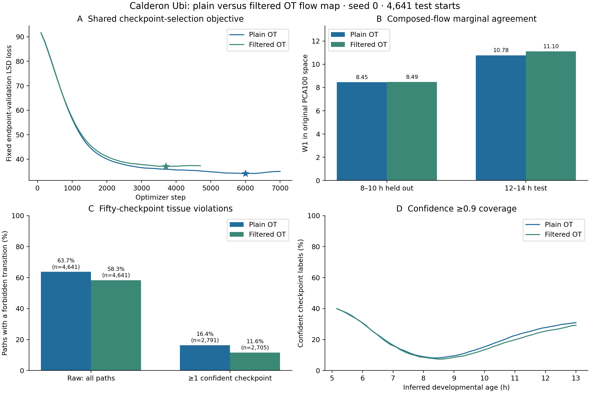

# Calderon filtered OT flow-map results

On the same **4,641 test starting cells**, raw fifty-checkpoint path violations change from **63.74%** with plain OT to **58.31%** with filtered OT. The ≥0.9 confidence-filtered rate changes from **16.37%** to **11.61%**, while assessed-path coverage changes from **60.14%** to **58.28%**. Both marginal W1 comparisons are reported below.

The filtered-interpolant variant completed **4,700 updates**. The shared plain-OT endpoint-validation objective selected **step 3,700**, with loss **37.0677**. Training took **98.64 minutes**. The comparison uses the same test cells, frozen tissue classifier, projected relation, 50 checking points and 100-step composed flow-map sampling as the plain-OT baseline.



| Metric | Plain OT | Filtered OT |
| --- | ---: | ---: |
| 8–10 h held-out W1 | 8.4545 | 8.4856 |
| 12–14 h test W1 | 10.7758 | 11.1041 |
| Raw path violations | 63.74% | 58.31% |
| Filtered violations among assessed paths | 16.37% | 11.61% |
| At least one confident checkpoint: coverage | 60.14% | 58.28% |
| All fifty checkpoints confident: coverage | 1.85% | 2.13% |
| Raw endpoint-only violations | 27.49% | 23.06% |

Filtered OT raw violations: **2,706/4,641 paths**. At probability ≥0.9: **314/2,705 assessed paths**, with **1,936 unassessed** and **99 confident at every checkpoint**. Skipped checkpoints are not demonstrated valid states; counts and coverage accompany the confidence-filtered rate.

W1 uses Euclidean ground cost in original PCA100 coordinates, uniform weights and the same 2,048 generated/reference samples. The middle comparison uses the state after 50 composed steps; the final comparison uses all 100. Neither held-out marginal selected a checkpoint.

| Paired raw status on the same starting cell | Paths |
| --- | ---: |
| Violation in both runs | 2,419 |
| Violation in plain OT only | 539 |
| Violation in filtered OT only | 287 |
| No raw violation in either run | 1,396 |

## Descriptive controls

These reuse the completed baseline controls because the starting cells, frozen classifier and reference samples are identical. Holding expression constant yields the same tissue predictions at all 50 checks. The controls are descriptive context, rather than formal lower bounds or corrections to subtract from a model score.

| Window | Unchanged-source W1 | Disjoint real-versus-real W1 |
| --- | ---: | ---: |
| 8–10 h | 8.2913 | 6.1406 |
| 12–14 h | 14.7481 | 10.2368 |

The unchanged-expression control gives **15.49% raw violations** and **1.04% confidence-filtered violations** among **1,916 assessed paths** (**41.28% coverage**).

## Training filter and transport mass

Training follows Maizels ID 5: mask forbidden released endpoint-label pairs, classify 50 interior linear-interpolant points with raw labels, check the released final target label, remove rejected edges and resolve the masked assignment. No generated-path penalty or tissue conditioning is used.

Across **4,700 optimizer batches**, the sampler checked **16,888,201 candidate interpolants** and rejected **15,261,943 (90.37%)**. Mean retained valid mass was **82.54%** per block. Its **601,600 optimizer pairs** were sampled after renormalizing retained mass. The statistics include the entire completed training run, including updates after the selected best checkpoint. Because the hard mask can require partial matching, the effective training tissue weights differ from the original snapshots.

A separate released-label support audit on this exact training split permits **99.9575%** of global endpoint mass. In **2,000 fresh 128-cell blocks**, the mean maximum endpoint-supported mass is **98.36%** (seed 3029). This uses endpoint labels alone; it provides context for the additional interpolant filter, rather than results for an endpoint-only trained model. The tiny global support deficit arises on the training split; the earlier audit of full endpoint snapshots allowed 100% tissue-level support.

| Endpoint | Tissue | Raw training fraction | Sampled optimizer fraction |
| --- | --- | ---: | ---: |
| Source | Unknown | 52.48% | 60.40% |
| Source | Epidermis | 12.65% | 10.01% |
| Source | Ectoderm | 9.34% | 10.30% |
| Source | Mesoderm | 6.95% | 5.37% |
| Source | Tracheal sys. | 5.68% | 3.24% |
| Source | Midgut | 5.38% | 3.78% |
| Source | Amnioserosa | 2.62% | 1.92% |
| Source | Brain | 2.60% | 2.57% |
| Source | Fore & hindgut | 2.29% | 2.40% |
| Target | Epidermis | 21.22% | 20.18% |
| Target | Somatic muscle | 10.48% | 10.86% |
| Target | Brain | 9.84% | 10.10% |
| Target | Neural | 7.77% | 8.51% |
| Target | Tracheal sys. | 7.49% | 6.95% |
| Target | Fore & hindgut | 7.26% | 8.04% |
| Target | Ventral nerve cord | 7.04% | 7.05% |
| Target | Fat body | 5.19% | 5.49% |
| Target | Midgut | 4.70% | 5.28% |
| Target | Muscle/Ubi | 4.28% | 1.42% |
| Target | Salivary gland | 3.42% | 3.89% |
| Target | Plasmatocytes | 3.41% | 3.83% |
| Target | Amnioserosa | 2.58% | 3.00% |
| Target | Sense | 2.23% | 2.59% |
| Target | Visceral muscle | 1.82% | 1.59% |
| Target | Midline/glia | 1.27% | 1.24% |

## Starting-tissue diagnostics

| Starting tissue | Test paths | Plain raw violations | Filtered raw violations | Filtered ≥0.9 violation rate | Filtered assessed-path coverage |
| --- | ---: | ---: | ---: | ---: | ---: |
| Unknown | 2,430 | 54.69% | 50.12% | 0.11% | 76.58% |
| Epidermis | 579 | 76.34% | 69.95% | 44.12% | 35.23% |
| Ectoderm | 451 | 57.65% | 52.55% | 14.67% | 33.26% |
| Mesoderm | 305 | 90.16% | 88.20% | 60.20% | 32.13% |
| Tracheal sys. | 282 | 96.10% | 90.07% | 55.05% | 38.65% |
| Midgut | 216 | 89.81% | 77.78% | 56.96% | 36.57% |
| Fore & hindgut | 135 | 42.22% | 40.74% | 15.12% | 63.70% |
| Brain | 131 | 58.02% | 45.80% | 27.91% | 32.82% |
| Amnioserosa | 112 | 48.21% | 35.71% | 14.67% | 66.96% |

Among the **2,211 test starts with a named tissue**, raw violations change from **73.68%** to **67.30%**. Confidence-filtered violations change from **50.17% (455/907)** to **36.97% (312/844)**, with coverage **41.02% → 38.17%**. The aggregate filtered rate depends strongly on `Unknown` starts: they supply **1,861/2,705** assessed paths, with only **2** violations. The named-tissue breakdown should accompany the overall rate.

## Interpretation and verification

The training filter certifies the selected linear PCA interpolants. Final trajectories come from a learned nonlinear flow map composed 100 times; the filter does not impose a hard constraint on those generated paths.

The same frozen classifier constructs the filtered training prior and scores generated paths. Its accuracy on real 8–10 h Ubi cells is 48.24%, and the unchanged-expression control already reports 15.49% raw violations. These are diagnostics of agreement with the reconstructed prior and classifier, not independent clone-fate accuracy. Both runs use the existing endpoint/reference-atlas protocol; the reference PCA/classifier can have seen endpoint flow-test cells. This single seed supplies no across-training-seed uncertainty estimate.

The saved audit verifies identical training/network settings, cell splits, reference samples, classifier and graph hashes; the selected checkpoint is the minimum of the shared endpoint-validation loss. All original baseline artifacts are preserved. The frozen GPU classifier matched PyTorch decisions on 6,912 training-cell/interpolant points, with maximum probability error below 7×10⁻⁷. Nineteen Calderon unit checks, seven shared OT regression checks and a genuine two-step training/evaluation smoke run passed.

Run artifacts: `/Users/harryamad/Desktop/drive/2026/flow-maps/outputs/calderon_ubi_filtered_ot_flow_map_seed0`. See `metrics.json`, `training_summary.json`, `pair_filtering_summary.json`, `comparison_protocol.json`, `classifier_backend_verification.json`, `best.msgpack` and the per-cell evaluation files. [Method and reproduction commands](filtered_flow_map.md) explain the training filter, partial assignment and matched validation protocol.

Reproduce this report:

```sh
/opt/anaconda3/envs/flowmaps/bin/python scripts/report_calderon_filtered_flow_map.py
```
