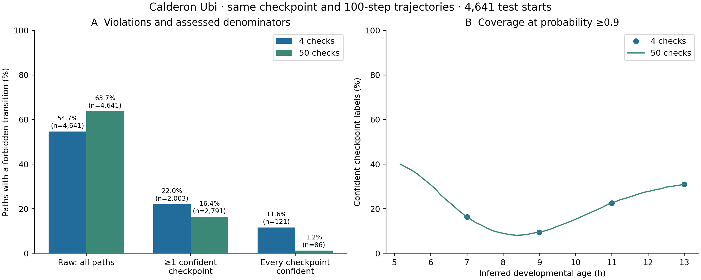

# Calderon OT flow map: 50 trajectory checks

The saved seed-0 step-6,000 EMA was evaluated at **50 equally spaced points**, normalized times **0.02, 0.04, …, 1.00**, or inferred ages **5.16, 5.32, …, 13.00 h**. The released source tissue at 5 h initializes the scan. All **4,641 test starting cells**, 100 composition steps, frozen classifier, tissue relation and ≥0.9 confidence threshold are unchanged. No training was performed.



| Metric | 4 checks | 50 checks |
| --- | ---: | ---: |
| Raw violations | 54.66% | 63.74% |
| Filtered violations among assessed paths | 22.02% | 16.37% |
| At least one confident checkpoint: coverage | 43.16% | 60.14% |
| Every checkpoint confident: coverage | 2.61% | 1.85% |
| Violations among paths confident at every checkpoint | 11.57% | 1.16% |
| Raw violating paths | 2,537 | 2,958 |
| Filtered violating paths | 441 | 457 |
| Assessed filtered paths | 2,003 | 2,791 |
| Fully assessed paths | 121 | 86 |

Raw violations rise from **2,537 to 2,958**. The filtered violation count also rises, **441 → 457**, but its assessed denominator grows **2,003 → 2,791**. The lower filtered percentage therefore accompanies greater coverage; it is not an improvement of the model. Uncertain checkpoints are skipped while retaining the last assessed tissue. Only **86/4,641 paths (1.85%)** are confident at all 50 checkpoints, and **1/86** of those paths violates the relation.

The grids are not nested: the original checks at t=0.25 and 0.75 are between the uniform fifty-point grid positions. The projected tissue relation also does not receive a second transitive closure. Individual classifications of path validity can therefore change in either direction as the checkpoint grid changes. Paired-path changes are:

| Status change | Paths |
| --- | ---: |
| New raw violations | 427 |
| Previously raw-violating, now no raw violation | 6 |
| New filtered violations | 16 |
| Previously filtered-violating, now no filtered violation | 0 |

Endpoint-only raw violations remain **27.49%**. W1 is unchanged: **8.4545** at 8–10 h and **10.7758** at 12–14 h. The extra checks change tissue-path evaluation rather than the flow or marginal comparisons.

The unchanged-expression control gives **15.49% raw** and **1.04% filtered** violations, with **41.28%** coverage. Its frozen probabilities were verified identical at all original checks, then repeated at the 50 times. The real 8–10 h Ubi classifier accuracy remains **48.24%**. These rates are noisy diagnostics of agreement with the reconstructed tissue prior; confidence abstention does not establish a valid complete path.

Verification confirmed that the checkpoint and all original run artifacts were unchanged, evaluation source/reference rows and IDs were identical, and regenerated coordinates at every original checkpoint matched exactly (maximum absolute difference **0.0**). The focused flow-map suite passed **14 tests**, including dense-grid validation and unchanged composed rollouts.

Dense evaluation artifacts: `/Users/harryamad/Desktop/drive/2026/flow-maps/outputs/calderon_ubi_ot_flow_map_seed0/evaluations/checkpoints50`. The validation audit and identity control are under `evaluation/`; per-path predictions, rejection times, confidence coverage and tissue strata are also saved there. See the [original training report](ot_flow_map_results.md) for training, marginal controls and the atlas holdout protocol.

Reproduce evaluation:

```sh
ENABLE_PJRT_COMPATIBILITY=1 JAX_PLATFORMS=METAL,cpu \
  .venv-flowmaps-metal/bin/python py/launchers/calderon_ot_flow_map.py \
  --stage evaluate --output-dir outputs/calderon_ubi_ot_flow_map_seed0 \
  --evaluation-output-dir outputs/calderon_ubi_ot_flow_map_seed0/evaluations/checkpoints50 \
  --checking-points 50 --classifier-python /opt/anaconda3/envs/maizels2023aa/bin/python
```

Reproduce comparison reporting:

```sh
/opt/anaconda3/envs/flowmaps/bin/python scripts/report_calderon_checkpoint_comparison.py
```
