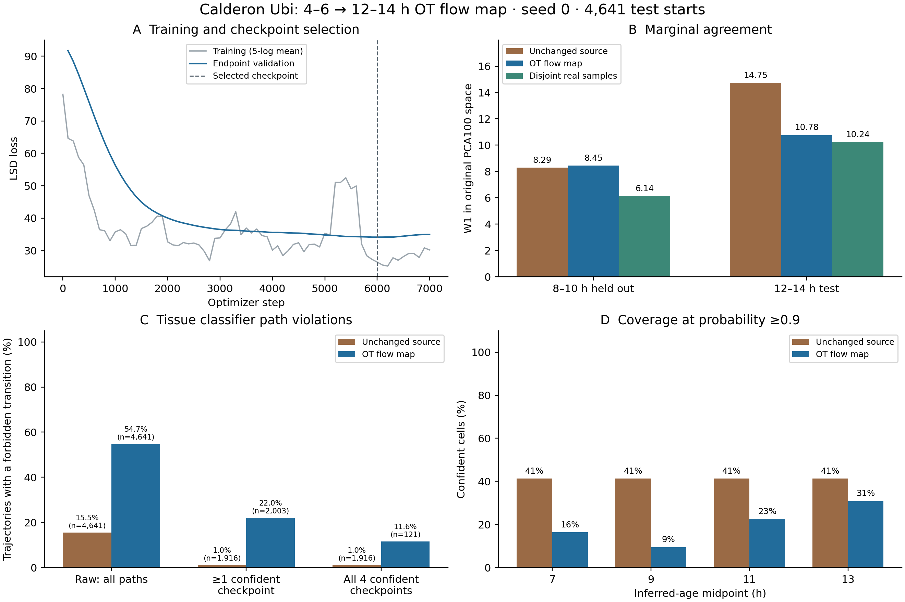

# Calderon OT flow-map results

The declared **4–6 → 12–14 h Ubi** experiment completed **7,000 optimizer steps**. Endpoint validation selected step **6,000**, with validation loss **34.1371**. Training took **2.76 minutes**. The 0.999 EMA was evaluated on **4,641 flow-test starting cells**; 8–10 h remained reserved for interpolation evaluation and did not select the checkpoint.



## Marginal agreement

| Evaluation marginal | OT flow map W1 | Unchanged-source W1 | Disjoint real-versus-real W1 |
| --- | ---: | ---: | ---: |
| 8–10 h held out | 8.4545 | 8.2913 | 6.1406 |
| 12–14 h test | 10.7758 | 14.7481 | 10.2368 |

W1 uses Euclidean ground cost in the original PCA100 coordinates and uniform cell weights, with **2,048 generated points** and up to 2,048 reference points per comparison. The unchanged-source control uses exactly the same source/reference samples. Real-versus-real compares disjoint samples from the same reserved marginal; it supplies sampling context rather than a formal lower bound.

The model reduces endpoint W1 by **26.93%** relative to unchanged sources. Its held-out 8–10 h W1 is slightly worse than that control, so this run shows endpoint improvement without evidence of improved interpolation at the reserved middle window.

## Tissue trajectory violations

| Path | Raw violation rate | Filtered rate among assessed paths | Assessed-path coverage | All-four-checkpoint coverage | Rate among all-four-assessed paths |
| --- | ---: | ---: | ---: | ---: | ---: |
| OT flow map | 54.66% | 22.02% | 43.16% | 2.61% | 11.57% |
| Unchanged expression control | 15.49% | 1.04% | 41.28% | 41.28% | 1.04% |

The scorer starts from each cell's released tissue label and checks generated labels at **7, 9, 11 and 13 h**. The confidence filter is probability ≥0.9 and probability margin ≥0.0. A path with no confident checkpoint is unassessed. The supplied projected tissue relation is used without another closure; Unknown retains its specified transitions.

The raw flow result is **2,537/4,641 trajectories**. The filtered result is **441/2,003 assessed paths**, with **2,638 unassessed** and **121 fully assessed paths**. The filtered rate permits skipped checkpoints and is not a complete-path assessment. Only **2.61%** of paths have all four checkpoints assessed.

Checking only the source-to-final tissue relation gives **27.49%** raw violations, compared with the whole-path rate above.

The unchanged-expression control reports 15.49% raw violations even though expression is held fixed. Its positive violations therefore reflect reference-label/classifier disagreement. This is a noise diagnostic; it should not be subtracted from the learned rate, because classification behavior changes along generated trajectories.

## Classifier checks on real evaluation cells

| Population | Cells | Accuracy | Confidence coverage | Accuracy among confident cells |
| --- | ---: | ---: | ---: | ---: |
| 4–6 h test starts | 4,641 | 79.29% | 41.28% | 98.59% |
| 8–10 h reference | 2,048 | 48.24% | 21.29% | 83.94% |
| 12–14 h test reference | 2,048 | 85.40% | 45.02% | 98.59% |

## Where paths first fail

| Midpoint (h) | First raw rejections | Fraction of all test paths | First filtered rejections | Confident coverage |
| --- | ---: | ---: | ---: | ---: |
| 7 | 867 | 18.68% | 17 | 16.38% |
| 9 | 592 | 12.76% | 112 | 9.48% |
| 11 | 615 | 13.25% | 209 | 22.52% |
| 13 | 463 | 9.98% | 103 | 30.92% |

## Starting-tissue strata

| Starting tissue | Test paths | Raw violations | Filtered violations among assessed paths | Filtered path coverage |
| --- | ---: | ---: | ---: | ---: |
| Unknown | 2,430 | 42.84% | 0.09% | 47.86% |
| Epidermis | 579 | 65.28% | 59.11% | 38.86% |
| Ectoderm | 451 | 48.56% | 25.90% | 30.82% |
| Mesoderm | 305 | 88.52% | 74.75% | 32.46% |
| Tracheal sys. | 282 | 95.04% | 88.12% | 35.82% |
| Midgut | 216 | 85.65% | 76.25% | 37.04% |
| Fore & hindgut | 135 | 40.74% | 17.95% | 57.78% |
| Brain | 131 | 53.44% | 34.04% | 35.88% |
| Amnioserosa | 112 | 45.54% | 23.94% | 63.39% |

## Scope and reproduction

This is one seed-0 unconstrained run of the declared native Maizels OT flow-map recipe, with three 1,024-unit hidden layers, batch size 128 and RAdam at 0.0003. The checkpoint was selected using fixed endpoint-validation batches and the sampling EMA. The saved model and all input hashes accompany the metrics. The Apple GPU backend matched CPU losses in a five-step full-model check.

The holdouts are for flow training. The frozen reference-atlas PCA and classifier can have seen endpoint flow-test cells. Ages and tissue labels are atlas-derived; these percentages measure agreement with the reconstructed prior and classifier, rather than traced clone-fate violations. A single seed supplies no across-training-seed uncertainty estimate.

Artifacts: `/Users/harryamad/Desktop/drive/2026/flow-maps/outputs/calderon_ubi_ot_flow_map_seed0`. See `metrics.json`, `training_summary.json`, `evaluation/controls/control_metrics.json`, the per-cell trajectory summaries and probability arrays, and `best.msgpack`.

Reproduce post-training reporting:

```sh
/opt/anaconda3/envs/flowmaps/bin/python scripts/report_calderon_ot_flow_map.py
```
