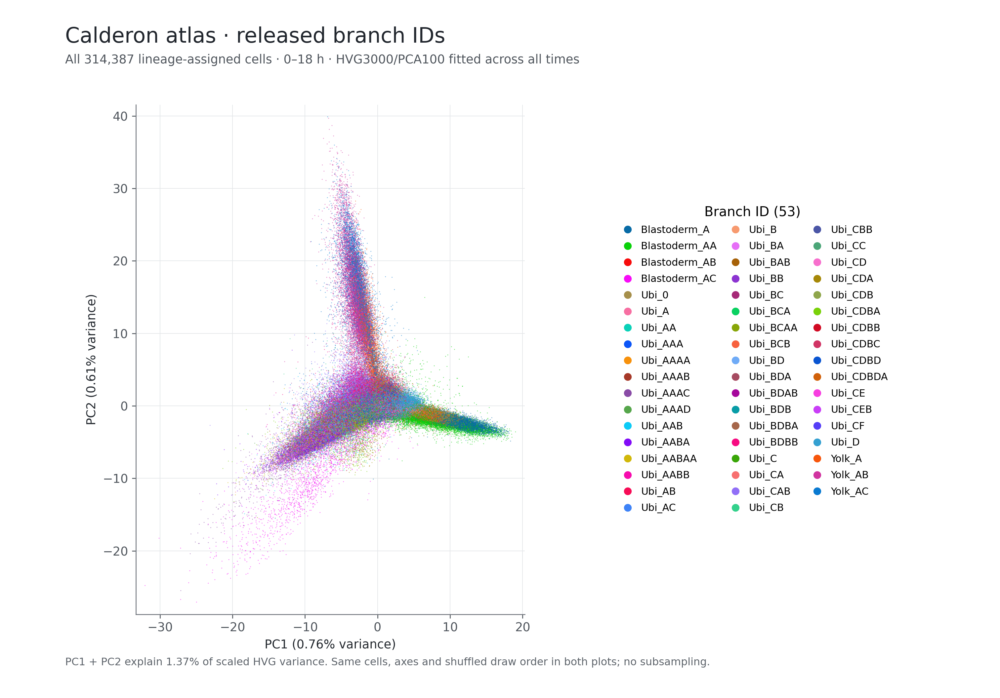
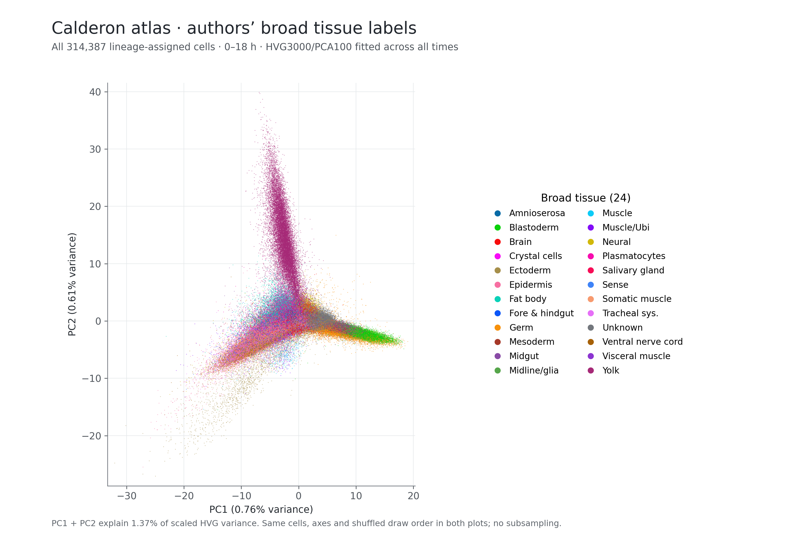

# Calderon cells in PC1/PC2

Both plots show **all 314,387 lineage-assigned cells across 0–18 h** from the new all-times HVG3000/PCA100 representation. The coordinates, axis limits and randomly shuffled draw order are identical. Every cell is plotted, with transparency 0.55 and draw-order seed 0.

PC1 explains **0.758%** and PC2 **0.615%** of scaled HVG variance, for **1.373% combined**. These two coordinates show a small part of the information available to the PCA100 classifiers.

## Released branch IDs

The colours identify the **53 released branch IDs**, joined to cells using the authors' time-window/cluster lineage table.



[SVG export](figures/all_times_pca2_branch_id.svg)

## Authors' broad tissue labels

The colours identify the **24 broad tissues** attached through the authors' [branch-to-tissue decoder](celltype_list_rna.txt). `Unknown` is shown in grey.



[SVG export](figures/all_times_pca2_broad_tissue.svg)

## Reproduction and provenance

The source is `datasets/calderon2022/all_times/lineage_assigned_hvg3000_pca100_all_times.h5ad`, with SHA256 `f3babb7934e5ef8c61e8cc6b7c6683af3651229af2c5da98d3a8c93607ae11e1`. Only `obsm['X_pca'][:, :2]` and the released annotation columns are read; the source dataset is verified unchanged after plotting.

Run from the repository root:

```sh
OPENBLAS_NUM_THREADS=2 OMP_NUM_THREADS=2 /opt/anaconda3/envs/maizels2023aa/bin/python \
  scripts/plot_calderon_pca2_labels.py
```

[Plot metadata](figures/all_times_pca2_labels.json) records the source hash, plotted class counts and colours, variance ratios, axis limits and draw-order seed. [The all-times classifier report](all_times_classification.md) describes the representation and label-holdout protocol.
