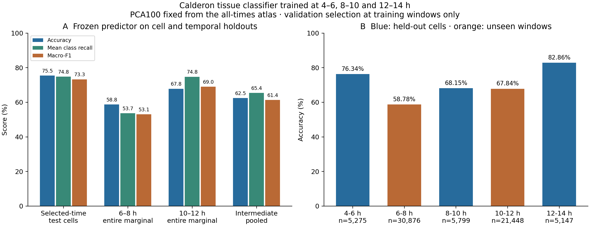
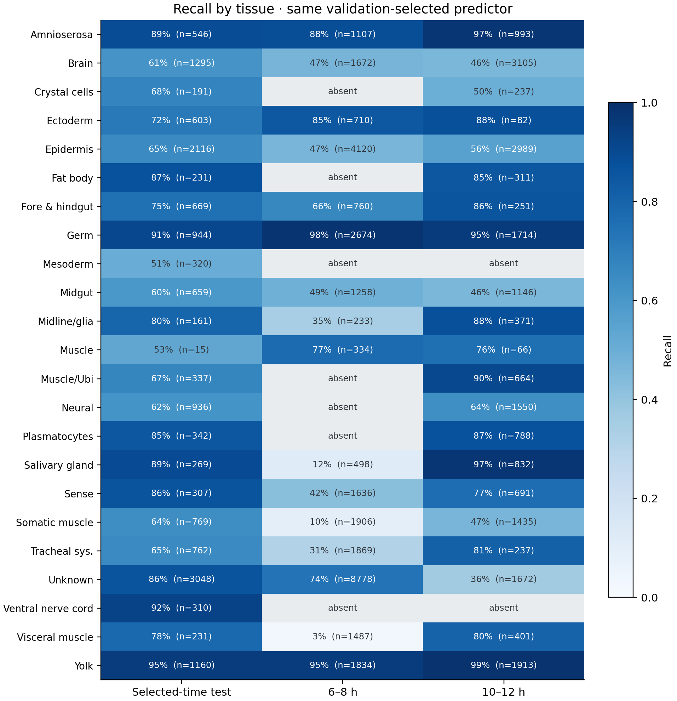

# Tissue classifier trained at three symmetric timepoints

The constraint classifier receives supervised training data only from **4–6, 8–10 and 12–14 h**. Its **23 tissue labels**, including `Unknown`, cover every tissue present within the retained 4–14 h interval. The **entire 6–8 and 10–12 h marginals** are excluded from classifier training, validation, calibration and model selection.

The selected predictor is **residual_mixup_ema+joint**, chosen using selected-time validation macro-F1. The following test scores were computed only after selection was frozen.

| Evaluation population | Cells | Present tissues | Accuracy | Mean class recall | Macro-F1 |
| --- | ---: | ---: | ---: | ---: | ---: |
| Held-out cells at 4–6, 8–10 and 12–14 h | 16,221 | 23 | **75.48%** | 74.81% | 73.28% |
| Entire 6–8 h marginal | 30,876 | 16 | **58.78%** | 53.67% | 53.09% |
| Entire 10–12 h marginal | 21,448 | 21 | **67.84%** | 74.76% | 68.96% |
| Both intermediate marginals pooled | 52,324 | 21 | **62.50%** | 65.45% | 61.36% |

Mean class recall and macro-F1 average the classes present in each evaluated population. The output vocabulary always contains 23 labels, even when a particular evaluation window contains fewer labels.



## Splits and representation

The three selected windows contain **162,206 cells**, split into **129,764 training / 16,221 validation / 16,221 test cells**. Stratification by inferred-age window and branch ID preserves tissue frequencies through the deterministic branch-to-tissue mapping. Every selected-time tissue and auxiliary branch class is represented in all three cell splits. The intermediate holdout contains **30,876 cells at 6–8 h** and **21,448 at 10–12 h**.

The **existing all-times HVG3000/PCA100 representation** is retained exactly; no HVG/PCA refit is performed. Its unsupervised fit includes all 314,387 lineage-assigned expression profiles, including temporal and cell holdouts. The classifier's additional PC standardizer is fitted on selected-time training cells only. Age, cluster IDs and annotation fields are excluded from predictor inputs. Outside-range cells are excluded from this classifier experiment.

The selected-time cache contains PC coordinates and annotations, with its expression matrix omitted. Every cached coordinate was checked against the original PCA by source row and cell ID.

## Accuracy by time window

| Window | Evaluation cells | Cells | Accuracy | Mean class recall | Macro-F1 |
| --- | --- | ---: | ---: | ---: | ---: |
| 4-6 h | Held-out cells | 5,275 | 76.34% | 66.49% | 67.89% |
| 6-8 h | Entire held-out marginal | 30,876 | 58.78% | 53.67% | 53.09% |
| 8-10 h | Held-out cells | 5,799 | 68.15% | 69.25% | 67.78% |
| 10-12 h | Entire held-out marginal | 21,448 | 67.84% | 74.76% | 68.96% |
| 12-14 h | Held-out cells | 5,147 | 82.86% | 84.24% | 83.72% |

## Training and validation selection

Five established recipes were retrained: wide, stronger class weighting, residual, residual with mixup/noise/label smoothing/EMA, and joint branch+tissue prediction. The joint recipe uses **46 selected-time branch labels** as an auxiliary target; its tissue head is evaluated here. No auxiliary supervision comes from intermediate windows. The models use the existing AdamW, five-epoch warmup/cosine schedule, batch size 2,048, gradient clipping at 5, a 160-epoch limit and 30-epoch early-stopping patience. Checkpoint selection, scalar temperature calibration and greedy ensembles of at most three members use selected-time validation cells only. This is one initialization and split seed.

| Recipe | Validation accuracy | Validation macro-F1 | Selected-time test accuracy | Intermediate pooled accuracy | Selected |
| --- | ---: | ---: | ---: | ---: | --- |
| wide | 75.91% | 73.84% | 74.65% | 61.30% |  |
| wide_balanced | 75.43% | 73.07% | 74.13% | 60.79% |  |
| residual | 75.41% | 73.26% | 73.95% | 61.65% |  |
| residual_mixup_ema | 76.51% | 74.10% | 75.01% | 62.14% |  |
| joint | 76.02% | 73.79% | 74.77% | 61.72% |  |
| ensemble | 77.03% | 74.87% | 75.48% | 62.50% | yes |

## Classifier confidence

| Evaluation population | Coverage at probability ≥0.9 | Accuracy among those cells | ECE (15 bins) |
| --- | ---: | ---: | ---: |
| Held-out cells at 4–6, 8–10 and 12–14 h | 47.06% | 96.75% | 0.0219 |
| Entire 6–8 h marginal | 35.63% | 90.75% | 0.1231 |
| Entire 10–12 h marginal | 46.79% | 92.58% | 0.0916 |
| Both intermediate marginals pooled | 40.21% | 91.62% | 0.1101 |

## Per-tissue performance



The per-class CSV files include precision, recall, F1, test support and training-cell support. Grey cells mark labels absent from the evaluation population. Confusion matrices and per-window metrics are also saved.

## Artifacts and verification

Classifier directory: `/Users/harryamad/Desktop/drive/2026/flow-maps/calderon-classifiers/symmetric_4_8_12`. The selected manifest is `models/symmetric_4_8_12_broad_tissue_selected.json`, with reloadable neural checkpoints and frozen calibration. `reports/` contains every candidate score, selected test probabilities, cell IDs and source PCA rows. The selected probability vectors were reproduced after manifest reload for all four evaluation populations.

The audit recomputes all selected metrics, checks disjoint supervised/temporal holdouts, frozen selection and checkpoint hashes, and verifies unchanged global PCA and reference-oracle artifacts. The four temporal-split checks passed. `results_validation.json`, `evaluation_complete.json` and `implementation_hashes.json` record verification.

The existing all-times ensemble is preserved for reference ('oracle') violation tracking. This newly trained classifier has separate weights and a 23-label vocabulary that omits `Blastoderm`; graph masks and reference predictions should be aligned by label name when integrating the flow experiment.

```sh
OPENBLAS_NUM_THREADS=2 OMP_NUM_THREADS=2 /opt/anaconda3/envs/maizels2023aa/bin/python \
  scripts/prepare_calderon_three_time_data.py

OPENBLAS_NUM_THREADS=4 OMP_NUM_THREADS=4 /usr/bin/caffeinate -i \
  /opt/anaconda3/envs/maizels2023aa/bin/python scripts/train_calderon_three_time_classifier.py --device mps
```
