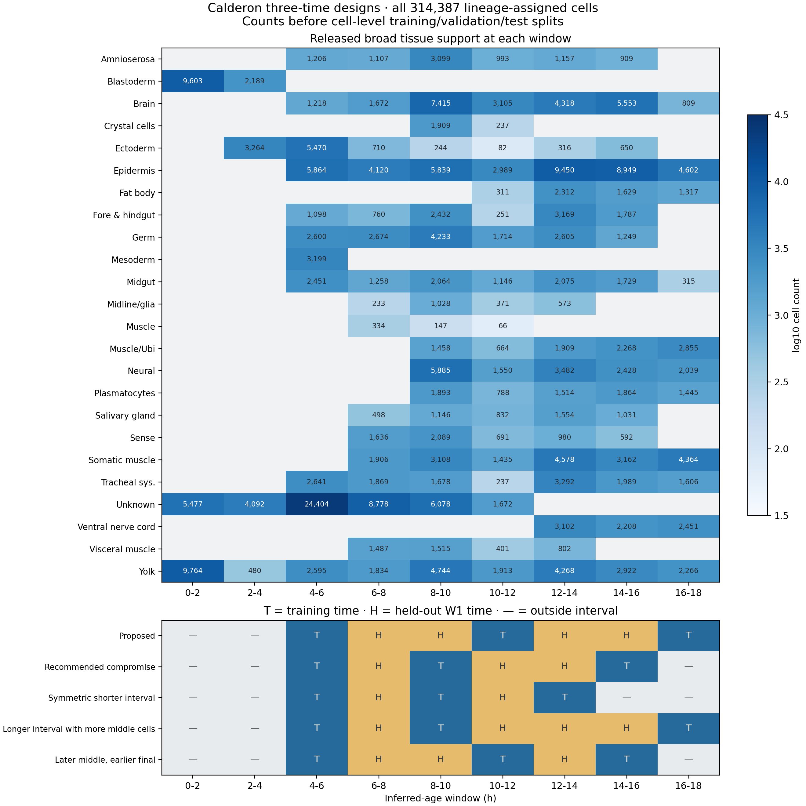

# Three-time Calderon experiment design

The selected follow-up uses **4–6 / 8–10 / 12–14 h**, retaining the **4–14 h** interval and all 23 tissues present within it. The [completed tissue-classifier experiment](three_time_classifier.md) achieves **75.48% accuracy on held-out cells from the selected windows** and **62.50% across the two entire intermediate marginals**. The schedules below preserve the original coverage and compatibility comparisons.

The proposed **4–6 / 10–12 / 16–18 h** training times cover all **23 tissue labels present within 4–18 h**. Only `Blastoderm` is absent from the global 24-label vocabulary; it occurs only before the selected interval.

No three windows cover all 24 atlas-wide labels. Four disjoint support requirements establish this: `Blastoderm` occurs at 0–2/2–4 h, `Mesoderm` only at 4–6 h, `Crystal cells` at 8–10/10–12 h, and `Ventral nerve cord` at 12–14/14–16/16–18 h. Exhaustive enumeration confirms a minimum of four windows. One four-window witness is 0-2 / 4-6 / 8-10 / 12-14 h.

## Candidate schedules

Counts below include `Unknown` and precede cell-level splits. All five candidates cover the 23 labels present between their first and last selected windows, with a held-out window in both gaps.

| Design | Training windows (h) | Held-out windows (h) | Cells at training times | Held-out-time cells |
| --- | --- | --- | ---: | ---: |
| Proposed | 4-6; 10-12; 16-18 | 6-8; 8-10; 12-14; 14-16 | 98,263 | 181,255 |
| Recommended compromise | 4-6; 8-10; 14-16 | 6-8; 10-12; 12-14 | 151,669 | 103,780 |
| Symmetric shorter interval | 4-6; 8-10; 12-14 | 6-8; 10-12 | 162,206 | 52,324 |
| Longer interval with more middle cells | 4-6; 8-10; 16-18 | 6-8; 10-12; 12-14; 14-16 | 134,819 | 144,699 |
| Later middle, earlier final | 4-6; 10-12; 14-16 | 6-8; 8-10; 12-14 | 115,113 | 140,336 |

## Support for rare classifier targets

Moving the middle training point to 8–10 h supplies more examples of the transient classes. The following labels are absent at 4–6, 14–16 and 16–18 h. For schedules ending at 14–16 or 16–18 h, their support comes entirely from the middle training window.

| Tissue | 8–10 h cells | 10–12 h cells |
| --- | ---: | ---: |
| Muscle | 147 | 66 |
| Crystal cells | 1,909 | 237 |
| Midline/glia | 1,028 | 371 |
| Visceral muscle | 1,515 | 401 |

The 12–14 h final-point alternative adds further `Midline/glia` and `Visceral muscle` examples. `Muscle` remains rare even with the earlier middle point: 147 cells before classifier validation/test splitting. Coverage is necessary for the classifier, but does not establish held-out-stage accuracy; the [completed selected-times classifier evaluation](three_time_classifier.md) measures that stage transfer separately.

## Compatibility with the existing tissue prior

Each interval below normalizes its full observed snapshots independently. We maximize coupling mass allowed by the existing projected tissue relation, subject to source and target histogram capacities. The remaining percentage is a lower bound on forbidden mass for an exactly balanced coupling. It is a graph/snapshot compatibility diagnostic, not a measured classifier or flow violation rate.

| Design | First consecutive interval: minimum forbidden mass | Second consecutive interval: minimum forbidden mass |
| --- | ---: | ---: |
| Proposed | 7.06% | 39.88% |
| Recommended compromise | 5.63% | 21.91% |
| Symmetric shorter interval | 5.63% | 20.38% |
| Longer interval with more middle cells | 5.63% | 39.49% |
| Later middle, earlier final | 7.06% | 20.59% |

The 16–18 h final marginal has only 11 tissue labels. Its approximately 40% compatibility floor in both long designs makes the lineage/marginal tradeoff substantial under the present prior. The earlier final windows reduce that floor to about 20–22%; it remains material. For soft constraints, report the tradeoff with W1. For filtered assignments, record supported mass and the changed sampling proportions.

## Selected design and information split

Use **4–6 / 8–10 / 12–14 h** for the selected symmetric pilot: training at **5 / 9 / 13 h**, evaluation at **7 / 11 h**, with 162,206 training-time cells before splitting and two interpolation checks. On a normalized 5–13 h clock, training is at **0 / 0.5 / 1** and evaluation at **0.25 / 0.75**.

The earlier compromise proposal, **4–6 / 8–10 / 14–16 h**, also covers all 23 in-range tissues, provides 151,669 cells before splitting, and leaves **6–8 / 10–12 / 12–14 h** for W1 evaluation. Its midpoint training clock is 5/9/15 h and evaluation clock 7/11/13 h. The longer **4–6 / 8–10 / 16–18 h** schedule remains an alternative for a 4–18 h benchmark, with the larger compatibility floor described above.

Use separate classifier weights for the two roles. The **constraint classifier** learns only from the selected training windows, with its own validation/test cell splits inside those windows and frozen weights during flow training. The existing **all-times reference ('oracle') classifier** supplies final violation tracking. Both use the same already fitted all-times PCA100 space. Outside-range windows are excluded from the flow benchmark. The intermediate-window marginals and labels are excluded from flow/constraint-classifier fitting and checkpoint selection; the reference classifier is intentionally allowed atlas information across all times.



## Reproduction

[three_timepoint_coverage.csv](three_timepoint_coverage.csv) contains all 84 ordered three-window choices. [tissue_counts_by_window.csv](tissue_counts_by_window.csv) contains every tissue/window count. [three_timepoint_audit.json](three_timepoint_audit.json) records source hashes, class support, the minimum-window proof, selected candidate counts and independently recomputed graph support. Existing support-table results were checked against the recomputation.

```sh
OPENBLAS_NUM_THREADS=2 OMP_NUM_THREADS=2 /opt/anaconda3/envs/maizels2023aa/bin/python \
  scripts/audit_calderon_three_timepoints.py
```
